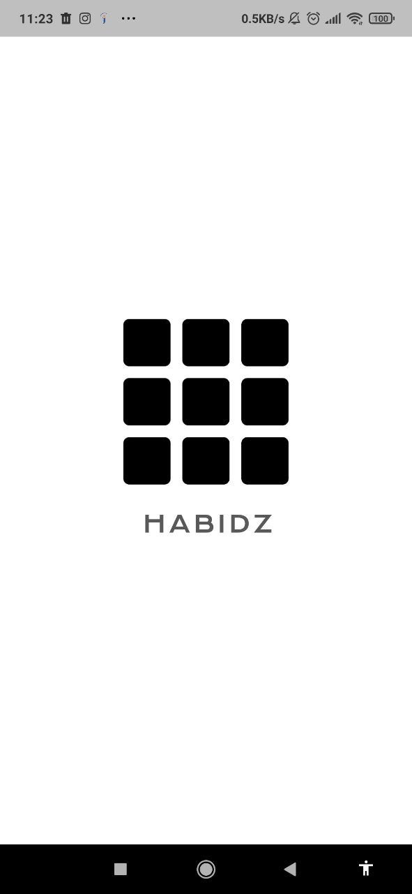
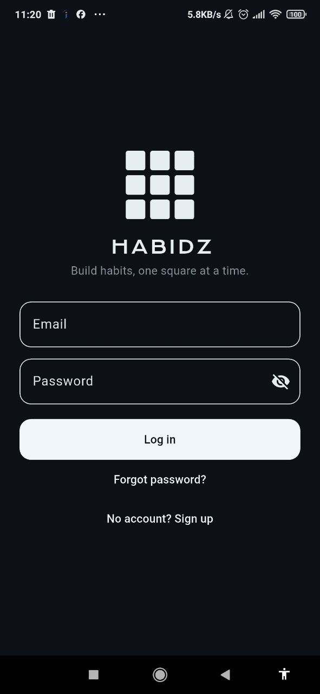
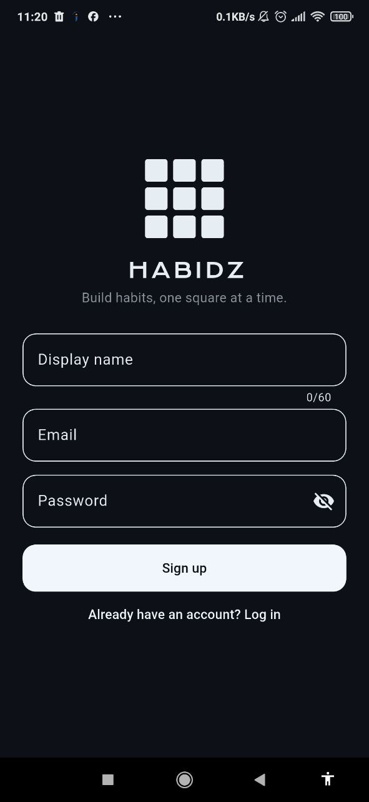
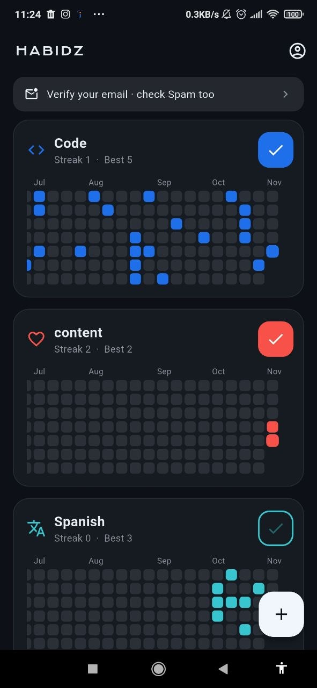
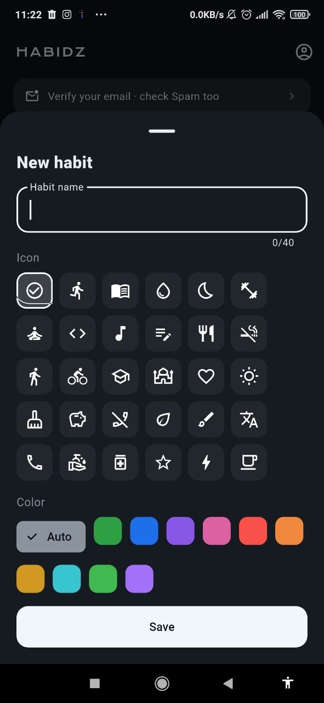
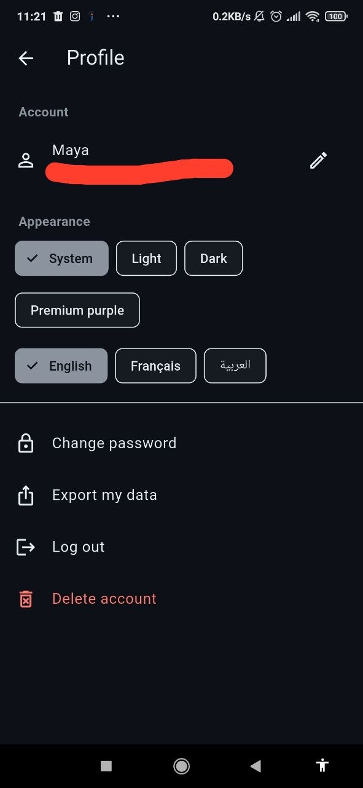
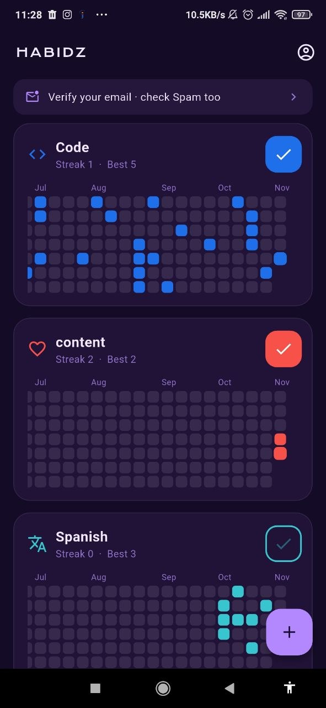
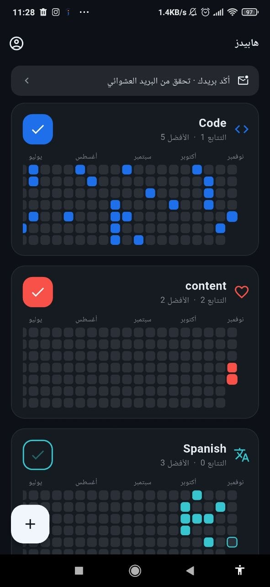

<p align="center">
  
</p>

<h1 align="center">Habidz</h1>

<p align="center">
  A habit tracker that looks like a GitHub contribution grid.<br>
  Add a habit, tap once a day, and watch a whole year of squares fill in.
</p>

<p align="center">
  
  
  
  
</p>

---

## Screenshots

<!--
  Add your screenshots to docs/screenshots/ with exactly these names
  (or change the names below). Phone screenshots look best at width 200.
-->

<table>
  <tr>
    <td align="center"><br><sub>Animated splash</sub></td>
    <td align="center"><br><sub>Sign in</sub></td>
    <td align="center"><br><sub>Create an account</sub></td>
    <td align="center"><br><sub>Your habit grids</sub></td>
  </tr>
  <tr>
    <td align="center"><br><sub>Pick an icon and colour</sub></td>
    <td align="center"><br><sub>Profile and settings</sub></td>
    <td align="center"><br><sub>Premium purple theme</sub></td>
    <td align="center"><br><sub>Arabic, right-to-left</sub></td>
  </tr>
</table>

## Features

- **GitHub-style grid.** Every habit is a card with a horizontally scrolling 53-week grid that opens on today. The list of habits scrolls vertically.
- **One-tap check-in.** Mark today with one tap, fix any past day by tapping its square. Future days are locked.
- **Streaks.** Current and best streak for every habit.
- **Your own habits.** Name, one of 30 icons and a colour, or *Auto* for black and white that follows the theme.
- **Archive or delete.** Hide a habit and keep its history, or delete it for good.
- **Accounts.** Sign up, log in, email verification, password reset, change password, edit your name.
- **Delete your account** from inside the app. All your data is erased, no support ticket needed.
- **Export your data** as JSON.
- **Themes.** System, light, dark and premium purple.
- **English, Français and العربية**, with a full right-to-left layout.
- **Works offline.** Check in without a connection and it syncs when you are back online.
- **Animated splash screen** and a logo that adapts to light and dark backgrounds.

## Tech stack

| Part | Choice |
|---|---|
| App | Flutter (Android first) |
| Login | Firebase Authentication (email and password) |
| Database | Cloud Firestore, protected by security rules, with its on-device offline cache |
| State | Plain Flutter (`ChangeNotifier`, `ListenableBuilder`, streams) |
| Settings | `shared_preferences` (theme and language) |
| Fonts | Krona One for the name (SIL OFL), system font elsewhere |
| Tooling | `flutter_native_splash`, `flutter_launcher_icons` |

Everything runs on free tiers. No server code and no paid plan are needed.

## Quick start

You need [Flutter](https://docs.flutter.dev/get-started/install) and an Android phone or emulator.

1. **Get the code**
   ```bash
   git clone https://github.com/goucem-meriem-malak/habidz.git
   cd habidz
   flutter pub get
   ```
2. **Firebase** (free Spark plan, no billing card)
   - Create a project at [console.firebase.google.com](https://console.firebase.google.com).
   - Authentication: enable **Email/Password**.
   - Firestore Database: create a database in production mode.
   - Run `dart pub global activate flutterfire_cli`, then `flutterfire configure` and choose Android. This creates `lib/firebase_options.dart` and `android/app/google-services.json`, both ignored by Git.
   - Publish the security rules: `cd firebase`, `firebase use YOUR_PROJECT_ID`, `firebase deploy --only firestore:rules`.
3. **Icon and splash** (generated from `assets/logo.png`)
   ```bash
   dart run flutter_launcher_icons
   dart run flutter_native_splash:create
   ```
4. **Run**
   ```bash
   flutter run
   ```

Build an APK to share:

```bash
flutter build apk --release
```

Everything else, including common problems and fixes, is in [docs/DOCUMENTATION.md](docs/DOCUMENTATION.md).

## Project structure

```
lib/
  main.dart            app start, themes, language, login check
  splash_screen.dart   animated logo splash
  brand.dart           app name style and theme-tinted logo
  auth_screen.dart     sign in, sign up, reset password
  home_screen.dart     habit list, verify-email notice, offline notice
  habit_card.dart      one habit: title, check button, grid
  habit_grid.dart      the painted grid and tap handling
  habit_editor.dart    add, edit, archive, delete
  habit_repo.dart      all Firestore access
  habit.dart           model, date helpers, streaks
  profile_screen.dart  profile, theme, language, password, export, delete account
  settings.dart        theme and language preferences
  theme.dart           themes, habit colours and icons
  l10n.dart            English, French and Arabic texts
firebase/              firestore.rules, firebase.json
assets/                logo.png and the font
docs/                  documentation, planning notes, screenshots
test/                  streak and date unit tests
```

## Status

Built and tested by hand on one Android phone. Only the streak logic has automated tests. iOS code is shared but has not been built or tested.

## License

[MIT](LICENSE). The license covers the code in this repository. The Krona One font keeps its own license (SIL Open Font License, see `assets/fonts/OFL.txt`).
