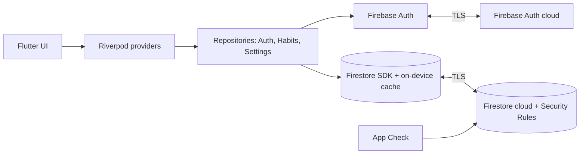

# Habidz — Architecture, project structure, data, security

## 1. Architecture

No custom backend. **Trust boundary = Firestore Security Rules + Auth.** All authorization and data validation are enforced there; the client is untrusted. Repositories are interfaces so Firestore can be swapped later.

## 2. Project structure (feature-first, Flutter conventions)
```
habidz/
├─ lib/
│  ├─ main.dart, app.dart            # bootstrap, router, theme/locale wiring
│  ├─ core/  theme/ l10n/ router/ utils/ widgets/   # tokens, shared components
│  └─ features/
│     ├─ auth/      (data, domain, presentation)
│     ├─ habits/    (grid widget, habit card, editor, repo)
│     ├─ profile/   (settings, delete account, export)
│     └─ onboarding/
├─ l10n/ app_en.arb app_fr.arb app_ar.arb
├─ firebase/ firestore.rules firestore.indexes.json firebase.json
├─ test/ integration_test/ firebase/rules_test/
├─ docs/  assets/icons/  .github/workflows/ci.yml
```
New feature → new folder under `features/`. Config: `firebase_options.dart` (public client config, not secret) + `l10n/`. No secrets exist in the repo (no server keys used).

## 3. Firestore schema
```
users/{uid}                      { displayName, createdAt, locale, theme, deletionRequested? }
users/{uid}/habits/{habitId}     { name, iconKey, colorKey|null, order, archived, createdAt, updatedAt }
users/{uid}/habits/{habitId}/years/{yyyy}   { days: { "MM-DD": true }, updatedAt }
```
- Mark day: `update({'days.03-14': true})`; unmark: `FieldValue.delete()`. Concurrent offline edits to different days never conflict; same day = last write wins (acceptable for a boolean).
- Email lives only in Firebase Auth (not duplicated).
- Limits: habit name ≤ 40 chars, ≤ 100 habits/user (free tier abuse guard; rules-enforced where possible), `days` keys must match `MM-DD`.
- No composite indexes needed (queries: habits ordered by `order`).
- Schema versioning: `schemaVersion` field on `users/{uid}`; additive changes preferred.
- Retention: data lives until user deletes habit/account; hard delete (no soft delete) except `archived` flag.

### Rules sketch (illustrative, not final)
```
match /users/{uid}/{document=**} {
  allow read, write: if request.auth != null && request.auth.uid == uid;
}
// final version adds per-collection field/type/size validation + tests
```

## 4. Offline behavior (strategy A)
| Item | Decision |
|---|---|
| Works offline | View, add/edit/delete habits, mark days, change theme/language |
| Needs online | Sign up, first login, password reset, change password, delete account, export |
| Local store | Firestore SDK persistent cache (default on Android/iOS) |
| Queue / retry | SDK-managed; survives restart |
| Conflicts | Per-day last-write-wins; habit fields last-write-wins |
| Indicators | Offline banner + "syncing" dot |
| Logout/switch account | Terminate + clear persistence, then sign out |
| Device loss | Data is in the cloud; local cache protected by OS sandbox/device lock only |

## 5. Security & privacy
**Data inventory:** email, display name, password (held only by Firebase Auth, hashed by Google — we never see it), habit names (user-written, can be personal → treat as private), check-in dates, preferences. No location, contacts, payments (v1), or children-targeted features (age gate: terms state 16+; see D7).

**Threats → controls**
| Threat | Control |
|---|---|
| Reading/editing another user's data (IDOR) | Rules scoped to `request.auth.uid`; rules unit-tested in emulator |
| Credential attacks | Firebase Auth throttling; min 8 chars + breached-simple check client-side; generic login errors; email enumeration protection enabled |
| Unverified/fake accounts | Email verification; App Check (Play Integrity / App Attest) to block non-app clients |
| Quota abuse / cost attack | Rules size/count limits, App Check, budget alerts |
| Data leakage in logs | No email/habit names in Crashlytics logs or errors; no analytics SDK |
| Stolen session on shared device | Logout wipes cache; sensitive actions (delete, change password) require re-auth |
| Insecure transport | TLS only (Firebase default); no cleartext allowed in Android manifest/iOS ATS |
| Supply chain | Few dependencies, pinned versions, `flutter pub outdated`/Dependabot |
| Account takeover via reset | Firebase reset email; notify via standard Firebase emails |

**Permission matrix:** User → CRUD only own `users/{uid}/**`. Unauthenticated → nothing. No admin role. (Firebase console access = owner only; enable 2FA on owner Google account.)
**Privacy:** privacy policy + terms (hosted URL), in-app deletion (R-04), JSON export (R-15), EU/GDPR-friendly by data minimization. Not legal advice — have the policy reviewed if you target the EU/FR commercially.

**Security verification checklist (release gate):** rules tests pass (owner allowed, other user denied, unauth denied, oversize/invalid denied) · App Check enforced · no secrets in repo (`gitleaks`) · logout wipes cache (manual+integration test) · delete-account leaves 0 docs (emulator test) · release build has debugging off.

## 6. UI design tokens (summary)
Rounded radius 12–16 dp for cards, ~25% for grid cells. Themes: Light (white/near-black, neutral greys), Dark (#0D1117-like surface, GitHub feel), Premium Purple (deep violet surfaces, soft purple accents). Habit palette ~10 colors verified for ≥3:1 contrast against surface. Font: system or Inter (+ Noto Sans Arabic / Cairo for Arabic). Accessibility: text scaling, semantic labels on cells ("March 14, completed"), focus order, reduced motion, never color-only (done cells also differ by fill vs outline).
