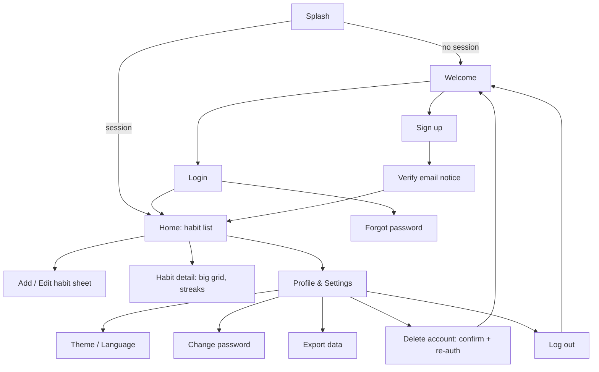

# Habidz — Project Spec (overview, requirements, UX)
Status: PLAN v0.1 — awaiting approval. No code exists yet.

## 1. Overview
Habidz is a habit tracker whose main view is a GitHub-style contribution grid. Each habit is a card with a horizontally scrollable grid of days; one tap marks today done.
- Users: individuals / general audience, worldwide. Languages: English, French, Arabic (RTL).
- Platforms: Android + iOS (Flutter). Business model: subscription (see decision D3).
- Roles: **one role (User)**. No admin panel in v1 (see D6).

## 2. Provisional assumptions (correct me if wrong)
| # | Assumption |
|---|---|
| A1 | Auth = email + password only (no Google/Apple login). Avoids Apple's "Sign in with Apple" rule and extra setup. |
| A2 | Account required (you asked for login/sign-up), so data syncs across devices and survives phone loss. |
| A3 | Day boundary = device-local calendar date. Marks stored as `YYYY-MM-DD`-style keys, not timestamps. |
| A4 | A habit is binary per day (done / not done). No counts, no reminders in v1. |
| A5 | Grid = last 53 weeks (≈ 1 year), rows = weekdays, scrolls horizontally, opens scrolled to today. |
| A6 | Subscription is NOT in the first build; v1 ships free, with premium hooks planned (D3). |

## 3. Requirements (MoSCoW)
**Must**
- R-01 Sign up (email, password, display name), log in, log out.
- R-02 Email verification + password reset by email.
- R-03 Profile screen: view/edit display name, change password, change theme/language.
- R-04 Delete account: re-authenticate, then permanently erase all cloud + local data.
- R-05 Add / edit / delete habit: name, icon, color (or "auto" = black/white per theme).
- R-06 Habit list: vertical scroll across habits; each card has a horizontally scrolling grid.
- R-07 Mark / unmark today with one tap (check button). Past days in the visible grid can be toggled; future days cannot.
- R-08 Works offline: all of R-05…R-07 work with no network and sync later automatically.
- R-09 Themes: Light, Dark, Premium Purple (+ follow-system as default).
- R-10 Languages EN/FR/AR with full RTL layout.
- R-11 Security baseline (section 5 of ARCHITECTURE doc).
- R-12 Privacy policy + in-app account-deletion path (required by Apple and Google stores).

**Should**
- R-13 Streak (current / longest) per habit, shown on card.
- R-14 Reorder habits (drag), archive habit (hide, keep data).
- R-15 Export my data (JSON) — privacy/GDPR portability.
- R-16 Haptic + subtle animation on check; respect reduced-motion.

**Could (future, not in v1)**
Daily reminders, home-screen widget, habit notes, per-habit stats screen, Google/Apple sign-in, premium subscription (RevenueCat), web app.

**Won't (v1)**: admin panel, social/sharing, ads, analytics tracking, AI.

### Acceptance criteria (key ones)
- R-07: tapping today's check changes state in <100 ms visually, persists after app kill, and appears on a second device within ~5 s when online.
- R-08: in airplane mode, create habit + check 3 days, restart app → data still there; reconnect → appears on the second device with no duplicates.
- R-04: after deletion, login with the old credentials fails and Firestore has zero documents under `users/{uid}`.
- R-10: in Arabic, all screens mirror (nav, back arrows, lists); **the grid itself stays oldest→newest left→right** (chart convention, decision D5), labels/numerals localized.

## 4. App lifecycle
1. Launch → native splash → init Firebase + local cache + saved settings (theme, language).
2. If a session exists (Firebase restores it, works offline) → Home. Otherwise → Welcome/Login.
3. Home shows cached habits instantly (skeleton only on very first load), then live updates.
4. Offline: small banner "Offline — changes will sync". Writes are queued by the SDK.
5. Expired/revoked session (password changed elsewhere, account deleted) → back to Login with a message; local cache of that user is wiped.
6. Logout wipes local cache for that user (shared-device safety).

## 5. Navigation map

Bottom/top bar: Home, Profile (two destinations only — keep it simple).

## 6. Screens
| Screen | Purpose / key content | States |
|---|---|---|
| Welcome | Logo, Log in / Sign up | — |
| Sign up | Name, email, password (strength hint), terms/privacy link | validation errors, email-in-use, offline ("needs internet") |
| Login | Email, password, forgot password | wrong credentials (generic message), rate-limited, offline |
| Verify email | Explains, "resend", "I verified" | cooldown on resend |
| Home | Vertical list of habit cards: icon, name, streak, today **check button**, horizontal grid; FAB "+" | empty (illustration + "Add your first habit"), loading skeleton, offline banner |
| Add/Edit habit | Name (max 40), icon picker (bundled set ~60), color picker (+ "Auto B/W"), save/delete/archive | name empty/duplicate, delete confirm |
| Habit detail | Larger grid, month labels, current/longest streak, total days | no data |
| Profile & Settings | Name, email, theme (System/Light/Dark/Purple), language, change password, export, logout, delete account | — |
| Delete account | Explains permanence, requires password, typed confirmation | wrong password, partial failure → "retry" |

Grid rules: 7 rows (Mon/Sun start per locale), 53 columns, rounded cells (radius ~25%), 4 intensity-less states: done (accent), empty, today (outlined), future (hidden). Colorful mode: habit color; "Auto" mode: white-on-dark / black-on-light. Min tap target 44 dp is met via the dedicated check button; grid-cell tapping for past days opens a small confirm toggle.

## 7. Core workflows
- **Sign up:** form → Firebase Auth creates user → create `users/{uid}` profile → verification email → Home (usable immediately; unverified banner; verification is required before premium purchase / export).
- **Daily check:** tap check → local write (instant UI) → SDK syncs. Tap again to undo.
- **Offline→online:** queued writes flush automatically; same-day conflicts resolved last-write-wins (see ARCHITECTURE).
- **Delete account:** re-auth → mark `deletionRequested` → batch-delete all habit + completion docs → delete profile doc → delete Auth user → wipe local cache → Welcome. Retry-safe if interrupted.
